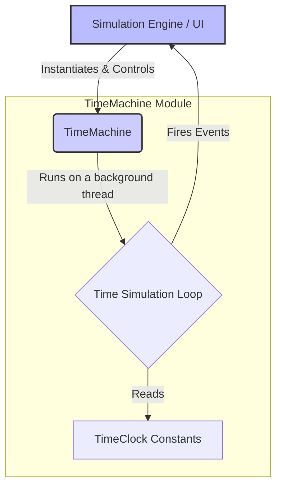
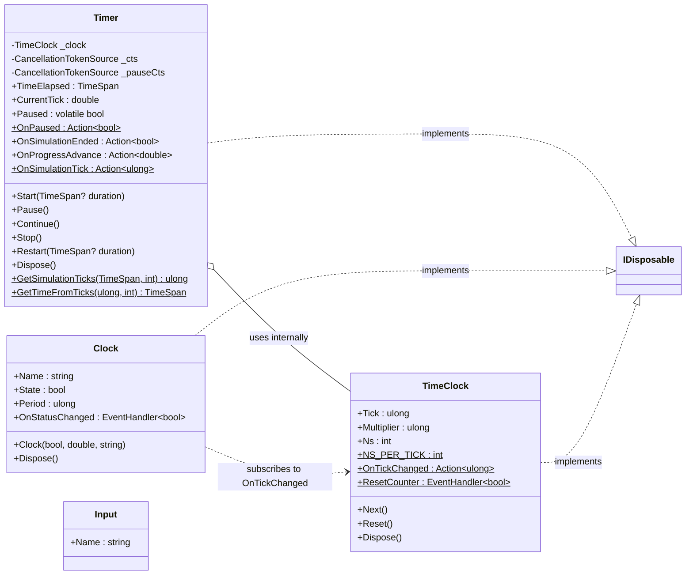
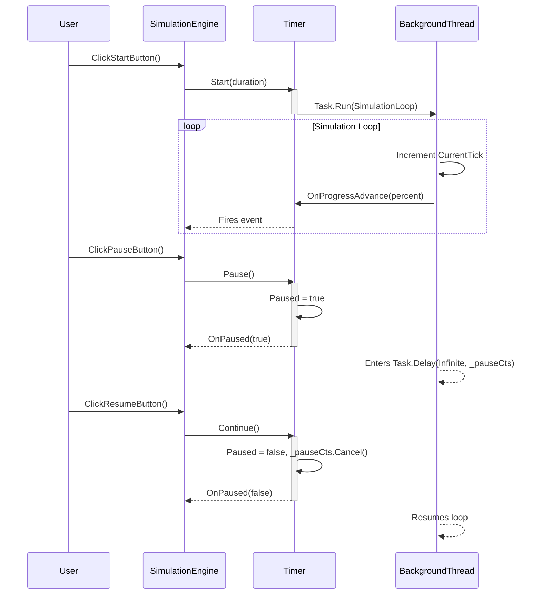
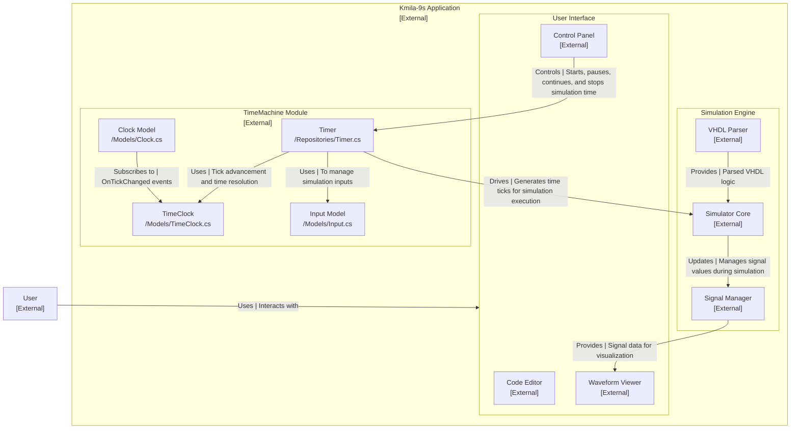
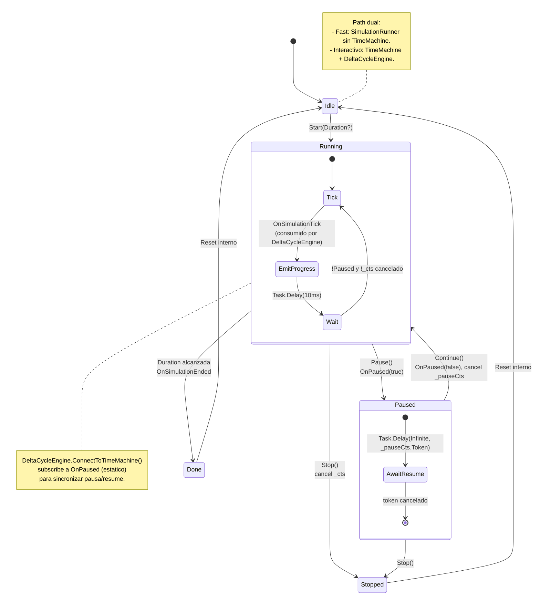

# TimeMachine Module

## Project: Kmila-9s

This module is a core component of **Kmila-9s**, a project officially titled "Aplicación Multiplataforma para el Aprendizaje y Depuración de Código VHDL sin Requerimiento de Hardware Físico" (Multiplatform Application for Learning and Debugging VHDL Code without Requiring Physical Hardware).

**Author:** Ulrich Tamayo Daniel
**Email:** dulricht1700@alumno.ipn.mx
**Email 2:** danielulrichtamayo@gmail.com
**Version:** 1.14.1
**Last Updated:** May 1, 2026

---

## 1. Project Overview

The primary goal of this project is to develop a free, open-source, and multiplatform desktop application for the interactive debugging of VHDL code. The application aims to facilitate the learning of digital design by providing a unified environment for simulation and real-time visualization of digital signals, clock cycles, and port states, completely eliminating the need for physical hardware like FPGAs.

### Key Motivations
*   **Accessibility:** Overcoming the financial barrier of expensive FPGA boards and proprietary software licenses.
*   **Pedagogical Improvement:** Offering an intuitive, integrated graphical interface that simplifies the debugging process, unlike the fragmented command-line workflows of tools like GHDL and GTKWave.
*   **Flexibility:** Providing a self-contained application that runs locally on multiple operating systems (Windows, macOS, Linux, Android, iOS) without requiring an internet connection.

This project is built using .NET and MAUI, ensuring a modern and maintainable codebase with broad platform support.

## 2. The TimeMachine Module

This specific module, the **TimeMachine**, serves as the heart of the simulation engine. Its primary responsibility is to provide a discrete, controllable time source that drives the entire VHDL simulation. It simulates the passage of time in discrete "ticks," allowing the simulation engine to execute VHDL processes and update signal values in a deterministic sequence, mimicking a real digital circuit's clock.

The module is designed to be highly flexible, offering precise control over the simulation's execution (start, pause, stop) and providing feedback through events.

### Core Responsibilities
*   **Discrete Time Simulation:** Generates a continuous stream of time ticks that represent the smallest unit of time in the simulation.
*   **Simulation Lifecycle Control:** Provides a simple API to `Start`, `Pause`, `Continue`, and `Stop` the time flow, enabling interactive debugging.
*   **Event-Driven Communication:** Notifies the main simulation engine and UI about important time-related events, such as progress updates (`OnProgressAdvance`) and simulation completion (`OnSimulationEnded`).
*   **Decoupling:** Separates the logic of time management from the logic of VHDL simulation, promoting a cleaner, more modular architecture.

## 3. Architecture of the TimeMachine Module

The module is built around a central `Timer` class that manages the simulation state and timing loop. It is designed to run on a background thread to ensure the application's UI remains responsive.

### Key Components

*   **`Timer.cs`**: The core class of the module. It orchestrates the time simulation, running a loop in a background `Task`. It manages the simulation's state (e.g., `IsRunning`, `IsPaused`) and exposes methods (`Start`, `Pause`, etc.) to control its lifecycle. It uses a `CancellationTokenSource` for efficient pausing and stopping.

*   **`TimeClock.cs`**: The global simulation clock that provides the fundamental "tick" driving all time-based events. It tracks the current tick count, handles tick overflow for long simulations, and defines the time resolution constant (`NS_PER_TICK = 10` nanoseconds per tick). Fires `OnTickChanged` and `ResetCounter` static events.

*   **`Clock.cs`**: Represents a single clock signal within the simulation. It subscribes to `TimeClock.OnTickChanged` events and toggles its state based on its frequency. Supports any frequency specified in MHz.

*   **`Input.cs`**: A placeholder class for future implementation of simulation input handling. Currently holds only the input name.

### Core Data Models

*   **Events (`Action<T>`)**: The `Timer` class uses several `Action` delegates as events to communicate with other parts of the application:
    *   `OnPaused` (static): Indicates that the simulation has been paused or resumed.
    *   `OnSimulationEnded`: Signals that a fixed-duration simulation has completed.
    *   `OnProgressAdvance`: Reports the simulation progress as a percentage.
    *   `OnSimulationTick` (static): Fires on each simulation tick for delta cycle processing.

## 4. How to Use This Module

To use the `TimeMachine`, you instantiate the `Timer` class and subscribe to its events. The simulation engine or UI can then call its control methods in response to user actions.

```csharp
using TimeMachine.Repositories;
using System;
using System.Threading.Tasks;

public class SimulationHost
{
    private readonly Timer _timeMachine;

    public SimulationHost()
    {
        // 1. Instantiate the TimeMachine.
        _timeMachine = new Timer();

        // 2. Subscribe to its events to receive updates.
        _timeMachine.OnProgressAdvance += (percent) => Console.WriteLine($"Progress: {percent}%");
        _timeMachine.OnSimulationEnded += (finished) => Console.WriteLine("Simulation Finished.");
        // Note: OnPaused and OnSimulationTick are static events on the Timer class
        Timer.OnPaused += (isPaused) => Console.WriteLine(isPaused ? "Simulation Paused." : "Simulation Resumed.");
    }

    public void RunSimulation()
    {
        // 3. Start the simulation for a defined duration (e.g., 1 microsecond).
        Console.WriteLine("Starting simulation...");
        _timeMachine.Start(TimeSpan.FromMicroseconds(1));

        // The simulation now runs on a background thread.
    }

    public void Pause() => _timeMachine.Pause();
    public void Continue() => _timeMachine.Continue();
    public void Stop() => _timeMachine.Stop();
}
```

## 5. Dependencies

This module is self-contained and has no external library dependencies beyond the standard .NET 9 runtime.

## 6. TimeMachine Flow and Class Relationships

To better understand the module's internal workings, the following diagrams illustrate the data flow and class relationships.

### 6.1. High-Level Simulation Flow

This diagram shows how the `TimeMachine` interacts with the broader simulation engine.



### 6.2. Detailed Class Diagram

This diagram details the key classes within the `TimeMachine` module.



### 6.3. Sequence Diagram: Starting and Pausing

This sequence diagram shows the runtime interactions when a user starts and then pauses the simulation.


### 6.4. Module Diagram


## 7. Current Limitations

The following limitations exist in the current implementation:

*   **Input Class Placeholder:** The `Input.cs` class is a placeholder with minimal implementation. Future versions will add properties for value, type, and time-based value changes.
*   **Fixed Tick Delay:** The simulation loop uses a fixed 10ms delay between ticks, which may not be suitable for all simulation scenarios.
*   **Thread Safety:** Only the `Paused` property is marked as `volatile`. Other fields may need synchronization for multi-threaded access.

## 8. Technical Details

### Time Resolution

The TimeMachine operates with a resolution of 10 nanoseconds per tick (`NS_PER_TICK = 10`). This value was chosen to provide sufficient precision for typical digital circuits while maintaining reasonable simulation performance.

### Clock Frequency Conversion

Clock frequencies specified in MHz are converted to simulation ticks using the formula:
```
Period (in ticks) = 1,000,000,000 ns / (frequency_MHz * 1,000,000) / NS_PER_TICK
                  = 1000 / frequency_MHz / NS_PER_TICK
```

For example:
- 50 MHz clock: Period = 1000 / 50 / 10 = 2 ticks per half-period
- 100 MHz clock: Period = 1000 / 100 / 10 = 1 tick per half-period

### Pause/Resume Mechanism

The pause mechanism uses `Task.Delay(Timeout.Infinite)` with a cancellation token, allowing the simulation loop to efficiently wait without consuming CPU cycles.

## 8.bis. Audit diagrams (2026-05-09)

The audit identified that the timer state machine and the dual fast/interactive
execution path were not depicted in the thesis diagrams. The block below is the
canonical view; the same source lives in
`Documentacion/TT1/diagrams/fig_5_11_11_state_timer.mmd`.

### `fig_5_11_11_state_timer` — Timer state machine



## 9. Changelog

### Version 1.14.1 (2026-05-01)

#### Documentation Verification

*   **README.md**: Verified all class signatures, events, and behaviors against the current codebase. Confirmed:
    *   `Timer` exposes `Start`, `Pause`, `Continue`, `Stop`, `Restart`, `Dispose`, plus `TimeElapsed`, `CurrentTick`, `Paused` (`volatile`), and the four events (`OnPaused` and `OnSimulationTick` are `static`; `OnSimulationEnded` and `OnProgressAdvance` are instance events).
    *   `TimeClock.Next()` increments `Tick`, fires `OnTickChanged`, and rolls into `Multiplier` with `ResetCounter` on overflow. `NS_PER_TICK = 10` ns is unchanged.
    *   `Clock` derives its half-period from `frequencyMHz` against `TimeClock.NS_PER_TICK`, subscribes to `OnTickChanged` and `ResetCounter`, and unsubscribes in `Dispose`.
    *   `Input` remains a placeholder holding only `Name`.
*   **Class diagram**: Marked `Paused` as `volatile bool` to match the field declaration.

---

### Version 0.5.2 (2026-02-21)

#### Documentation Fixes

*   **Clock.cs**: Added XML documentation for private members (`_halfPeriod`, `_currentTick`, `OnResetGlobalClock`)
*   **README.md**: Fixed sequence diagram to accurately reflect pause/resume mechanism (uses `Paused` flag + `_pauseCts` token, not `_cts.Cancel()`)
*   **README.md**: Fixed usage example to correctly reference `Timer.OnPaused` as a static event instead of instance event

---

### Version 0.5.1 (2025-12-13)

#### Diagram Updates

*   **Class Diagram (6.2)**: Updated to include all module classes:
    *   Added `Clock` class with properties (Name, State, Period, OnStatusChanged) and methods (Tick, Dispose)
    *   Added `Input` class (placeholder for simulation inputs)
    *   Updated `TimeClock` to show actual static members (NS_PER_TICK, OnTickChanged, ResetCounter events)
    *   Added relationship showing Clock subscribes to TimeClock.OnTickChanged
    *   Added IDisposable implementation indicator for Clock

---

### Version 0.5.0 (2025-12-13)

#### Documentation Improvements

*   **Models/Input.cs**: Added comprehensive XML documentation including:
    *   Class-level documentation explaining placeholder status
    *   Future use cases for input signal handling
    *   Property documentation with examples
    *   Cross-references to related classes

*   **Program.cs**: Added complete XML documentation including:
    *   Class-level documentation explaining test configuration
    *   Method documentation with available commands table
    *   Inline comments explaining clock frequency choices
    *   Notes about infinite loop behavior

*   **README.md**: Added version information, current limitations section, technical details section, and this changelog

---

### Version 1.14.0 (2026-04-19)

*   **Build hygiene** — added `<NoWarn>` for the remaining XML-doc /
    nullable-ref noise so the project builds warning-free alongside the
    rest of the Kmila solution.
*   No runtime behavior changes in this release; the TimeMachine clock
    tick engine is stable and consumed unchanged by the hybrid
    FPGA-default / per-project-override clock system added in
    `Kmila.Shared.Services.SimulationParameters`.

---

## What's new in v1.15 (2 May 2026)

- **Automated test runner (#6).** `Program.cs` was previously an interactive REPL that blocked on `Console.ReadLine()` and made the module impossible to validate non-interactively. Replaced with a 23-test runner exiting with code 0/1 based on pass/fail. Cases:
  - 8 Clock semantics tests (period calculation at 50 / 100 MHz, initial state, toggle, frequency ratio, dispose unsubscribes from `OnTickChanged`).
  - 4 TimeClock unit tests (Next, OnTickChanged, Reset, NS_PER_TICK constant).
  - 8 Timer lifecycle tests (Start with finite duration, Pause stops advancement, Continue resumes, Stop resets, Restart, monotonic OnProgressAdvance).
  - 3 stress tests (100 concurrent clocks, 50k tick run, 20 rapid Start/Stop cycles).
- **Workstation GC** enabled at the project level (#7); peak RSS during the 23-test run is ~37 MB.

Full release notes: [`../Documentacion/CHANGELOG_v1.15.md`](../Documentacion/CHANGELOG_v1.15.md).

---
*Last Updated: 2026-05-02*
